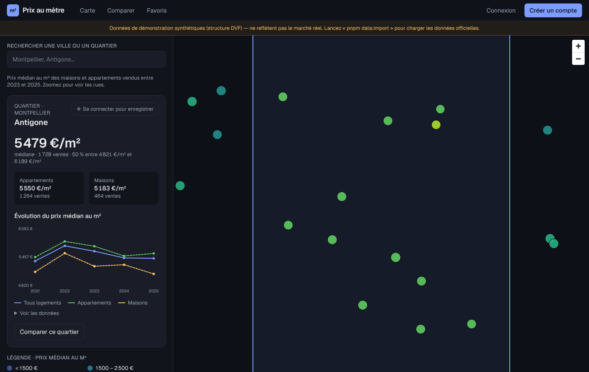
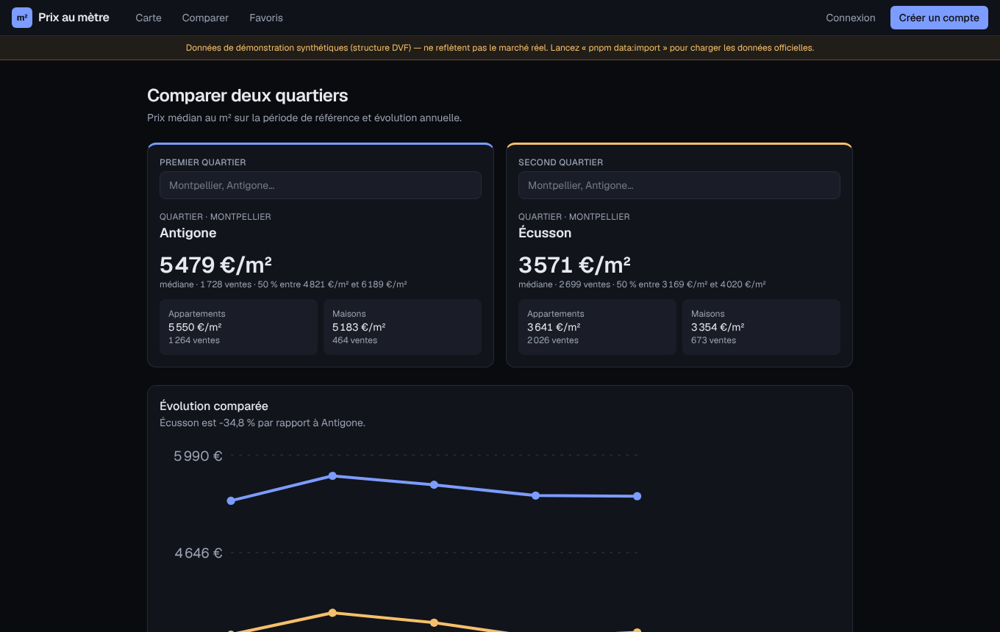

# Prix au mètre

Interactive map of French residential property prices — median **€/m², street by street**, built from the official DVF open dataset. Search a city or neighbourhood, see the price trend over recent years, compare two neighbourhoods side by side and save favourites.

> **Live:** https://prixaumeter.siavashizadi.com — real DVF data for Hérault, 2021–2025 (104 883 sales after cleaning). The benchmark below uses synthetic data at national scale (5 M sales).

| Map (neighbourhood selected) | Comparison |
|---|---|
|  |  |

*(Screenshots were taken offline, so the OpenFreeMap basemap is missing; in production the price layer sits on a dark street map.)*

## Features

- **Map (R1)** — MapLibre GL. At zoom ≥ 13 each street is a circle coloured by median €/m² (colour-blind-safe viridis scale), sized by number of sales; below that, communes. Hover for a tooltip, click for details. Every visible item is also listed as a button for keyboard and screen-reader users.
- **Search (R2)** — accessible combobox. Neighbourhoods (INSEE IRIS) and communes via accent-insensitive fuzzy search in PostgreSQL; cities also via the official Géoplateforme geocoder (typos, postcodes).
- **Trend (R3)** — yearly median €/m² for all dwellings, houses and apartments, with a data table.
- **Comparison (R4)** — two neighbourhoods side by side: medians, sample sizes, interquartile range, % gap and overlaid trends.
- **Favourites (R5)** — email/password accounts; users only ever see and modify their own favourites.
- **Honest numbers (A4)** — any figure backed by fewer than 10 sales is withheld *on the server* and shown as "Données insuffisantes".

## Architecture

```
                 ┌──────────────── Next.js 16 (App Router, standalone) ────────────────┐
 Browser ──────▶ │ React Server Components: layout, header (session), favourites page │
 (MapLibre,      │ Client components: map, search combobox, trend chart, compare     │
  React 19)      │ Route handlers /api/*  ── Zod validation ── error mapper ──┐      │
                 │   map · search · areas · streets · favourites · auth · health │      │
                 └───────────────┬───────────────────────────────┬──────────────┘      │
                                 │ raw SQL (pg)                  │ Prisma 7 (adapter-pg)
                                 ▼                               ▼
                 ┌──────────────────────── PostgreSQL 16 ──────────────────────────┐
                 │ sale (cleaned mutations, point + GiST) · commune · iris         │
                 │ mv_street_stats · mv_area_year_stats · mv_area_stats (medians)  │
                 │ user · session · account · favorite · import_run                │
                 └───────────────────────────────▲─────────────────────────────────┘
                                                 │ batched INSERT (unnest), REFRESH CONCURRENTLY
 data.gouv.fr geo-dvf CSV ──▶ scripts/import-dvf.ts: download → Zod → clean (A3) → IRIS point-in-polygon
 IRIS GeoJSON           ──▶
```

```
src/
  app/            pages (/, /comparer, /favoris, /connexion, /inscription) and /api route handlers
  components/     UI (map, search, trend chart, compare, favourites, auth form)
  lib/            pure, unit-tested code: stats, DVF row schema + cleaning, IRIS index, validation
  server/         server-only: pg pool, Prisma, auth, SQL, queries, favourites service, geocoder
prisma/           schema.prisma + hand-written migration (MVs, GiST/trigram indexes)
scripts/          import-dvf, seed-synthetic, bench, db-reset, screenshots
tests/            unit (Vitest) · integration (Vitest + Postgres) · e2e (Playwright + axe)
```

Key choices are justified one line each in [DECISIONS.md](DECISIONS.md).

### API

| Method | Path | Auth | Description |
|---|---|---|---|
| GET | `/api/map?layer=streets\|communes&minLon&minLat&maxLon&maxLat` | – | GeoJSON for the viewport (street layer limited to 0.6° × 0.4°) |
| GET | `/api/search?q=` | – | Neighbourhoods + communes (2–80 chars) |
| GET | `/api/areas/{iris\|commune}/{code}` | – | Period summary by property type + yearly trend |
| GET | `/api/streets/{key}` | – | Street summary |
| GET / POST | `/api/favorites` | session | List / add (`{ irisCode }`) the caller's favourites |
| DELETE | `/api/favorites/{id}` | session | Remove one of the caller's favourites (404 otherwise) |
| GET | `/api/health` | – | Liveness + DB check |

Errors are uniform: `400 { error, issues[] }` for validation, `401/403/404 { error }`, `500 { error: "Erreur interne" }` (details only in server logs).

### Security

- All inputs validated with Zod on the server (query strings, path params, bodies).
- Better Auth: scrypt password hashing, server-side sessions, httpOnly SameSite=Lax cookies (`Secure` behind HTTPS), rate-limited auth endpoints.
- Favourites: user id taken from the session only, every query scoped by `user_id`, foreign ids → 404; mutations require a same-origin `Origin` (CSRF defence-in-depth). Proven by `tests/e2e/access-control.spec.ts`.
- Security headers (nosniff, frame deny, referrer policy, permissions policy), `noindex` (DVF terms).
- Secrets only from environment variables (`.env.example`); Postgres is not exposed outside the Docker network.

## Data source and licence

- **DVF géolocalisées** (Demandes de valeurs foncières, DGFiP, geocoded by Etalab), published on data.gouv.fr: `https://files.data.gouv.fr/geo-dvf/latest/csv/{year}/departements/{dept}.csv.gz`. Licence **Licence Ouverte / Open Licence 2.0**. DVF terms of use additionally forbid **re-identifying persons** and **search-engine indexing** of the data: the app only publishes aggregated medians, never individual sales, and every page is `noindex`.
- **Neighbourhoods**: INSEE **IRIS** contours (IGN/INSEE, Licence Ouverte), via the Opendatasoft `georef-france-iris` GeoJSON export.
- **Geocoding**: Géoplateforme (IGN) `https://data.geopf.fr/geocodage` — successor of `api-adresse.data.gouv.fr`, no key.
- **Basemap**: OpenFreeMap "dark" style — free, no key, commercial use allowed; © OpenMapTiles, © OpenStreetMap contributors.
- **Synthetic data** (`pnpm db:seed:synthetic`): same CSV layout, real Hérault commune codes/names, invented streets, prices and IRIS shapes. Used in development and CI; flagged in the UI by a banner.

### Data cleaning rules (A3)

Price per m² = `valeur_fonciere / surface_reelle_bati`, houses and apartments only. Per mutation:

| Rule | Keeps |
|---|---|
| R-NATURE | `Vente` and `Vente en l'état futur d'achèvement` |
| R-DWELLING | exactly one distinct house/apartment (outbuildings allowed) — DVF repeats the *total* value on every line |
| R-MIXED | no commercial/industrial premises in the mutation |
| R-VALUE | value present and > 0 |
| R-SURFACE | 9 m² ≤ surface ≤ 1 000 m² |
| R-COORDS | coordinates present and within France |
| R-BOUNDS | 200 €/m² ≤ price ≤ 30 000 €/m² |
| R-FENCE | per department × type × year (n ≥ 30): ln(price) within [Q1 − 1.5·IQR, Q3 + 1.5·IQR] |

Every rejection is counted by reason in `import_run.rejections`. Figures are **medians** (`percentile_cont`), shown only with **≥ 10 sales**; "current" figures use the 3 most recent years.

## Query benchmarks (R7)

Target: **p95 ≤ 50 ms** server-side execution for every key query, at **national scale (5 M sales)**. Measured with `EXPLAIN (ANALYZE, BUFFERS)` on the exact SQL the API runs (`src/server/sql.ts`), 25 runs after warm-up. Full plans: [docs/benchmarks.md](docs/benchmarks.md).

<!-- BENCH:START -->
**Dataset:** 5,000,000 sales · 651,998 streets · 42,756 IRIS · 35,000 communes (synthetic, national scale).
**Load:** batched insert 93.3 s · materialized view refresh + VACUUM ANALYZE 52.6 s.

| Query | p50 | p95 | max | rows | ≤ 50 ms |
|---|---:|---:|---:|---:|:-:|
| Map — streets, largest allowed viewport on the densest area | 1.04 ms | 1.59 ms | 1.81 ms | 1779 | ✅ |
| Map — communes, whole metropolitan France (zoom 5) | 23.55 ms | 26.55 ms | 27.91 ms | 4000 | ✅ |
| Search — fuzzy prefix matching ~42 k near-identical names (worst case) | 2.78 ms | 3.12 ms | 5.37 ms | 8 | ✅ |
| Search — typo in a city name | 10.13 ms | 14.97 ms | 15.37 ms | 8 | ✅ |
| Trend — yearly medians of one IRIS | 0.02 ms | 0.06 ms | 0.06 ms | 15 | ✅ |
| Comparison — period summary of one IRIS (×2 per comparison) | 0.01 ms | 0.03 ms | 0.07 ms | 3 | ✅ |
<!-- BENCH:END -->

What made the difference (all found by this benchmark): search went from **~380 ms → ~3 ms** by switching from GIN + CTE to a GiST trigram **KNN** scan; the national commune view went from **~65 ms → ~25 ms** by applying `LIMIT` before the join.

Re-run: `BENCH_DATABASE_URL=postgresql://…/pam_bench pnpm bench --sales 5000000` (the bench database is wiped).

## Running it

Requirements: Node 22, pnpm 10, PostgreSQL 16 (or Docker).

```bash
cp .env.example .env                 # set DATABASE_URL and BETTER_AUTH_SECRET (openssl rand -base64 32)
pnpm install
pnpm db:migrate                      # prisma migrate deploy
pnpm data:import --dept 34           # real Hérault data 2021–2025 (download cached in data/raw)
#   or: pnpm db:seed:synthetic       # offline synthetic data
pnpm dev                             # http://localhost:3000
```

Import options: `--dept 34 --years 2021-2025`, `--source-dir <dir>` (local files laid out as `<year>/<dept>.csv.gz`), `--iris-file <geojson>`, `--skip-refresh`. Re-running is safe: each department-year is replaced atomically. Other departments: run it again with another `--dept`.

### Tests

```bash
pnpm lint && pnpm typecheck
pnpm test                 # unit: cleaning rules, medians, low-sample threshold, IRIS index
pnpm test:integration     # SQL aggregates == TS reference, idempotency (needs seeded DB)
pnpm build && pnpm test:e2e   # Playwright: search → map → trend → comparison → favourite + axe; access control
```

### Deployment (VPS, Docker)

Images are built and pushed to GHCR by CI (`ghcr.io/tysia-fr/prix-au-meter`, `…-tools`); the server only pulls them.

```bash
# on the server — only compose.yaml, .env and deploy/ are needed
cp .env.example .env && nano .env    # POSTGRES_PASSWORD, BETTER_AUTH_SECRET, BETTER_AUTH_URL=https://prixaumeter.siavashizadi.com
docker compose up -d db
docker compose run --rm tools pnpm db:migrate
docker compose run --rm tools pnpm data:import --dept 34
docker compose up -d app
docker image rm ghcr.io/tysia-fr/prix-au-meter-tools:latest   # reclaim disk
sudo cp deploy/nginx-prixaumeter.conf /etc/nginx/sites-available/prixaumeter.siavashizadi.com
sudo ln -s /etc/nginx/sites-available/prixaumeter.siavashizadi.com /etc/nginx/sites-enabled/
sudo nginx -t && sudo systemctl reload nginx && sudo certbot --nginx -d prixaumeter.siavashizadi.com
```

Update: `docker compose pull app && docker compose up -d app`.

CI (GitHub Actions): lint · types · unit → Prisma migrations · synthetic import + idempotent re-import · integration · build · Playwright/axe, and a Docker image build.

## Known limits

- Streets are drawn as points (median position of their sales): DVF has no street geometry.
- IRIS boundaries change over time; sales are assigned with the current contours.
- Medians over 3 years hide very recent moves; the trend chart shows them per year.
